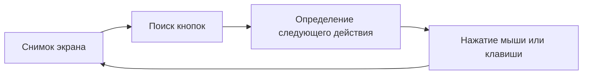
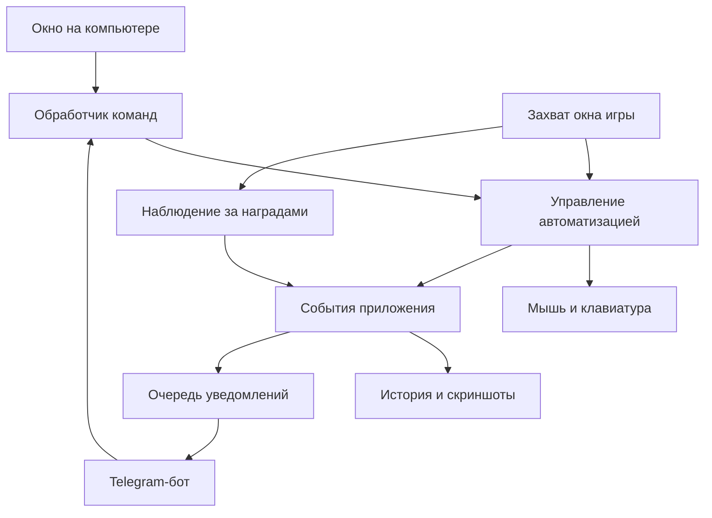

# Переписка о fortnite-automatic-lap и Sprite Pilot

Экспорт доступного текста пользовательских сообщений и ответов ассистента, включая сообщения о ходе работы. Порядок сохранён; точное время отдельных сообщений недоступно. Служебные инструкции, внутренние рассуждения и JSON вызовов инструментов не включены. Текст перенесён из доступной истории чата, а не получен официальным экспортом ChatGPT. Оригиналы пяти пользовательских изображений не были доступны как файлы; их места отмечены отдельно. Экспорт заканчивается сообщением о подготовке архива; финальная ссылка на этот архив появится в чате после его создания.

## Сообщение 1 · Пользователь

привет, у тебя есть память про обсуждение жетона в chatgpt?

## Сообщение 2 · Ассистент

Привет! В текущем чате я не вижу предыдущего обсуждения жетона, а другие твои чаты мне недоступны. Напомни, о каком жетоне речь, или пришли фрагмент обсуждения — продолжим.

## Сообщение 3 · Пользователь

посмотри на гитхабе ppkk12/fortnite-automatic-lap, получится ли сделать форк? последнего релиза

## Сообщение 4 · Ассистент · Ход работы

Посмотрю репозиторий и последний релиз, чтобы понять, можно ли сделать форк и что для этого потребуется.

## Сообщение 5 · Ассистент

Да, **сделать форк получится**. Проверил репозиторий и исходники последнего релиза:

- Последний релиз — [v2.0.0](https://github.com/ppkk12/fortnite-automatic-lap/releases/tag/v2.0.0), опубликован **8 ноября 2026**.
- Исходники доступны по тегу `v2.0.0`: Python, интерфейс Tkinter, распознавание кнопок через OpenCV.
- Лицензия **MIT** разрешает изменения и распространение с сохранением лицензии и уведомления об авторстве.
- Есть `build_exe.bat` для сборки своего `.exe` под Windows. Саму сборку я пока не проверял.

Для своей версии нужно создать форк репозитория и рабочую ветку **от тега `v2.0.0`**. Готовый `pk-auto.exe` из релиза автоматически в форк не переносится.

Форк пока не создавал. Что хочешь изменить в своей версии?

## Сообщение 6 · Пользователь

смотри мне хотелось бы чтобы уведомления и управление приходили не в дискорд а в телеграм, а то в дискорде маленький рейт лимит, а также чтобы можно было смотреть награды типа sprite gizmo, которые появляются только в течении матча и их не видно в конце, когда бот делает скриншот наград

## Сообщение 7 · Ассистент · Ход работы

Проверю, где в этой версии находятся уведомления и управление через Discord и как делается скриншот наград. Для Sprite Gizmo понадобится отслеживать появление награды во время матча.

## Сообщение 8 · Ассистент

Да, обе доработки реализуемы, но нашёл существенный нюанс: **публичные исходники урезаны относительно готового `.exe`**. В описании релиза v1.9.4 есть Discord, удалённые команды и Loot Vault, а в коде тега v2.0.0 этих модулей нет. Поэтому мой предыдущий ответ уточню: форк сделать можно, но собрать полный аналог последнего `.exe` из опубликованного кода пока не подтверждено.

Для твоей задачи можно добавить:

- **Telegram:** уведомления, скриншоты, команды запуска, остановки и проверки состояния. Команды принимать только от твоего Telegram ID; отправку делать через очередь с обработкой лимитов — у Telegram они тоже есть.
- **Награды во время матча:** отдельно отслеживать появление Sprite Gizmo, сохранять скриншот в момент обнаружения и отправлять его в Telegram. Повторные кадры одной награды объединять, а найденные награды сохранять в истории матча.

Есть два пути: добавить эти функции в открытый код или сделать отдельную программу рядом с оригинальным ботом, которая будет отслеживать награды и отправлять уведомления. Для полной замены существующего Discord-управления предпочтительнее получить актуальные исходники автора.

Пришли скриншот появления **Sprite Gizmo во время матча** и уточни, какой вариант тебе нужен: собственный форк или дополнение к оригинальному `.exe`?

## Сообщение 9 · Пользователь

давай сначала архитектуру приложения объяснить лучше, а версию 2.0 думаю можно декомпилировать если достать оттуда .pyc, автор в дискорд не отвечает

## Сообщение 10 · Ассистент

Я бы строил это как **приложение на твоём Windows-компьютере, а Telegram использовал для управления и просмотра результатов**. Игра, распознавание экрана и нажатия работают локально; Telegram передаёт команды и получает уведомления.

Сначала уточнение: сейчас мы знаем устройство опубликованных исходников. **Что именно внутри `pk-auto.exe` версии 2.0, я ещё не исследовал.**

### Как устроен открытый код

В нём уже есть простая цепочка:

За неё отвечают следующие файлы:

| Модуль | Что делает |
|---|---|
| `main.py` | Окно приложения, запуск и остановка рабочего потока |
| `vision.py` | Снимки экрана и поиск изображений кнопок через OpenCV |
| `state_machine.py` | Обычный цикл: играть → продолжить → пропустить → вернуться в лобби |
| `mode_b.py` | Отдельный режим выхода через меню после ожидания |
| `controller.py` | Нажатия |
| `anti_afk.py` | Периодические нажатия WASD |
| `focus.py` | Поиск окна игры и работа с ним |
| `config.py`, `i18n.py` | Настройки, пути к изображениям и переводы |

Основа пригодна для расширения. Но в опубликованном коде нет того Discord-управления и хранилища наград, которые упоминаются в описании готовой программы.

### Как я предлагаю устроить нашу версию

Разделить приложение на независимые части:

**1. Ядро автоматизации**

Хранит состояние: остановлен, поиск матча, матч, результаты, восстановление после ошибки. Решает, когда нажать кнопку.

Окно приложения и Telegram обращаются к одному обработчику команд. Поэтому «Остановить» на компьютере и `/stop` в Telegram выполняют одно и то же действие. Удалённая остановка должна оставлять приложение работающим, чтобы его можно было снова запустить.

**2. Захват экрана**

Один компонент получает кадры окна игры и передаёт их распознаванию кнопок и наблюдателю наград.

Это позволяет независимо настроить частоту проверки. Например, кнопки искать раз в секунду, а область кратковременных уведомлений проверять чаще. Точные интервалы выберем по длительности появления награды и нагрузке.

**3. Наблюдатель наград**

Он работает **во время матча**, независимо от переходов между меню. Для Sprite Gizmo цепочка будет такой:

1. Найти на экране уведомление о награде.
2. Определить награду по изображению, тексту или их сочетанию.
3. Сохранить полный кадр и вырезку уведомления.
4. Записать время и текущий матч.
5. Отправить уведомление в Telegram.

Нужна защита от повторов: одна плашка, видимая на двадцати кадрах, должна дать одно событие. При этом повторное получение такой же награды позже должно учитываться отдельно.

**Одной видимой иконки предмета недостаточно для вывода «награда получена»**: нужно распознавать именно уведомление о получении. Здесь понадобится пример экрана.

**4. История**

Локальная SQLite-база хранит матчи, найденные награды и события; изображения лежат отдельными файлами. Тогда можно посмотреть награды даже после перезапуска или временного отсутствия интернета.

**5. Telegram**

Начальный набор команд:

- `/status` — состояние и длительность работы;
- `/start` и `/stop` — управление;
- `/screenshot` — текущий экран игры;
- `/rewards` — награды текущего или последнего матча.

Команды принимаются только от разрешённого Telegram ID. Отправка идёт через очередь: повторяющиеся ошибки объединяются, ограничения API обрабатываются с ожиданием. Потеря связи с Telegram не должна останавливать локальную работу или терять сохранённые награды.

### Насчёт декомпиляции 2.0

**Да, извлечение `.pyc` — разумный первый шаг**, если `.exe` действительно собран PyInstaller. Но извлечь байткод и восстановить читаемые исходники — разные задачи.

В репозитории есть два способа сборки:

- обычный PyInstaller;
- PyArmor + PyInstaller, с защитой Python-кода.

Пока неизвестно, каким способом собран релиз 2.0. При обычной сборке восстановление может оказаться относительно простым, хотя результат зависит от версии Python и поддержки декомпилятора. При PyArmor извлечённые `.pyc` могут содержать защищённую оболочку вместо доступной логики.

Поэтому следующий шаг — **скачать `.exe` и статически проверить упаковку, версию Python и наличие защиты**. После этого станет понятно, можем ли восстановить существующие Discord и Loot Vault или эти части придётся реализовать заново. Предложенная архитектура подходит для обоих вариантов.

## Сообщение 11 · Пользователь

скачай, приложил скрины управления в дискорд

> Вложения: четыре скриншота Discord. Оригиналы изображений недоступны в файловой среде экспорта. На них показаны панель pk-auto с языком бота, Link key, Settings, A Normal, B Island, WASD, языком приложения, DM interval, Mode B wait; Screen check; Rescue с Esc, Click center, Restart loop и сеткой A1–D4. Эта заметка описывает вложения, но не заменяет исходные изображения.

## Сообщение 12 · Ассистент · Ход работы

Скачаю `pk-auto.exe` версии 2.0 и проверю его упаковку и Python-модули без запуска. На скриншотах вижу переключение режимов A/B, WASD, интервалы уведомлений, запрос экрана и восстановление через Esc, клик по сетке и перезапуск цикла — учту это для Telegram.

## Сообщение 13 · Ассистент · Ход работы

Файл скачан, SHA-256 совпал с указанным в релизе. Это PyInstaller-сборка с Python 3.12; основной модуль уже извлечён. В списке файлов признаков PyArmor пока нет — проверю сам байткод и состав модулей.

## Сообщение 14 · Ассистент · Ход работы

Нужные модули нашлись: `remote`, `telemetry`, `shot`, `rescue`, `loot_vault` и `reward_shot`. Их байткод читается, признаков PyArmor в них нет.

Также выяснилось, что приложение работает через сервер-посредник автора. В коде есть собственные интервалы опроса и пауза 300 секунд между отправками наград — задержки зависят не только от лимитов Discord. Текущий обработчик наград привязан к кнопкам получения; для Sprite Gizmo понадобится отдельное наблюдение во время матча.

## Сообщение 15 · Ассистент

Скачал [pk-auto v2.0.0.exe](/workspace/fortnite-analysis/downloads/pk-auto-v2.0.0.exe) и разобрал без запуска. Хеш совпадает с релизом GitHub.

**Твоя идея с `.pyc` сработала:** это PyInstaller с Python 3.12. Извлечены 48 модулей приложения, их байткод читается; признаков PyArmor не найдено. Читаемые `.py` пока не восстановлены.

Нашёл нужные части:

- `remote`, `telemetry` — удалённые настройки и уведомления;
- `shot`, `rescue`, `rescue_grid` — скриншоты, восстановление и сетка A1–D4 со скриншотов;
- `loot_vault`, `reward_shot` — сохранение и отправка наград.

**Важное открытие:** клиент общается с сервером автора, который обслуживает Discord. Поэтому заменить только адрес на Telegram не получится — нужен свой транспорт команд и уведомлений. В клиенте также есть собственные задержки: например, пауза **300 секунд** между отправками наград.

Текущее распознавание наград привязано к кнопкам получения. Для Sprite Gizmo нужен отдельный наблюдатель во время матча.

Сохранил [подробный разбор](/workspace/fortnite-analysis/reports/ANALYSIS.ru.md) и [архив `.pyc`, листингов и инструмента извлечения](/workspace/fortnite-analysis/pk-auto-v2.0.0-static-analysis.zip). Отдельно обнаружена подсистема лицензирования — её проверки не изменялись.

## Сообщение 16 · Пользователь

значит тогда надо вытаскивать .py.
можно добавить вот это и что еще? думаю можно чутка поменять дизайн приложения чтобы выглядело поприятнее, и еще что нибудь

## Сообщение 17 · Ассистент · Ход работы

Начну восстанавливать `.py` из извлечённого байткода и проверю, насколько хорошо декомпилятор справляется с Python 3.12. Для своей версии предлагаю Telegram-панель, историю наград со скриншотами и новый интерфейс с понятным статусом. Из полезных дополнений — сохранение настроек, профили и журнал событий.

## Сообщение 18 · Ассистент · Ход работы

Получены все 48 файлов `.py`. Они проходят проверку синтаксиса, но это ещё не готовая рабочая сборка: декомпилятор отметил неполное восстановление в семи модулях, а проверка нашла ошибки вроде вызовов `None`. При этом у 521 блока кода инструкции совпали с исходным байткодом. Сохраняю результат с отчётом, чтобы было видно, какие места требуют исправления.

## Сообщение 19 · Ассистент

**Уже получил 48 файлов `.py`** — [архив восстановленного кода](/workspace/fortnite-analysis/pk-auto-v2.0.0-recovered-python.zip). Все проходят проверку синтаксиса, но семь модулей восстановлены неполностью; есть ошибки декомпиляции, которые нужно исправить по байткоду. Это пока материал для доработки, не рабочая сборка.

Telegram, награды во время матча и обновление дизайна можно включить в нашу версию. Я бы добавил ещё:

- **Галерею наград:** изображение, название, время и матч; фильтры и просмотр полного скриншота.
- **Избранные награды:** уведомлять сразу о выбранных предметах, остальные собирать в сводку.
- **Паузу при нужной находке:** остановить автоматику и прислать снимок для проверки.
- **Профили настроек:** под разные разрешения, языки и режимы.
- **Диагностику распознавания:** показывать, какую область бот проверяет и почему не находит кнопку.
- **Итоги сессии:** время работы, циклы, найденные награды и случаи зависания.
- **Сохранение при потере интернета:** находки остаются на компьютере, уведомления отправляются после восстановления связи.

По дизайну предлагаю **тёмный графитовый интерфейс с голубым акцентом**, боковым меню и разделами «Обзор», «Автоматизация», «Награды», «Telegram», «Журнал». На главном экране — текущий этап, статистика, последняя находка и крупные кнопки запуска и остановки. Подробные настройки убрать с главного экрана.

Записал [предложение по функциям и интерфейсу](/workspace/fortnite-analysis/reports/PRODUCT.ru.md). Порядок работы вижу таким: исправить восстановленный код → подключить Telegram → добавить наблюдение наград → обновить интерфейс. Для распознавания Sprite Gizmo ещё понадобится скриншот именно его появления в матче.

## Сообщение 20 · Пользователь

проблема в распознавании sprite gizmo - там 5 вариантов устройства, но подписаны снизу они одинаково. в остальном можно делать

> Вложение: один скриншот поисковой выдачи с изображениями разных устройств над одинаковой надписью YOU FOUND SPRITE GIZMO. Оригинал изображения недоступен в файловой среде экспорта. Скриншот не использовался как игровой обучающий образец.

## Сообщение 21 · Ассистент · Ход работы

Тогда надпись `Sprite Gizmo` будем использовать для обнаружения награды, а вариант определять по иконке устройства над ней. Если иконка распознана неуверенно, приложение сохранит снимок с пометкой «вариант не определён». Начинаю реализацию; для проверки всех пяти вариантов позже понадобятся чёткие кадры каждого.

## Сообщение 22 · Ассистент · Ход работы

В восстановленном коде нашёл серьёзную ошибку: рабочий цикл декомпилирован с пустым телом. Поэтому новую версию собираю на открытом ядре репозитория, а восстановленный код использую для сверки функций. Telegram, историю и распознавание пяти вариантов отделю от автоматики, чтобы их можно было проверять независимо.

## Сообщение 23 · Ассистент · Ход работы

Собрана первая версия: новый интерфейс, Telegram-панель, локальная галерея, очередь доставки и настройка пяти вариантов по иконкам. Неполный набор образцов не будет давать ложную уверенность — такие находки сохраняются как неопределённые. Сейчас проверяю повторы наград, ограничения удалённых команд и поведение при сбоях сети.

## Сообщение 24 · Ассистент · Ход работы

Проверки проходят: пять иконок различаются при одинаковой надписи, повторы одной плашки не создают новые записи, а неоднозначные изображения остаются неопределёнными. Проверены также права Telegram и сохранение сообщения после ответа `429`. Интерфейс уже запущен в деморежиме. Готовлю архив и скрипты для Windows; реальная игра и живой Telegram-бот здесь ещё не проверены.

## Сообщение 25 · Ассистент · Ход работы

Все 47 тестов прошли. Пакет также установлен отдельно от исходников и успешно запущен; архив со скриптами для Windows готов. Для работы с настоящими Sprite Gizmo в приложении нужно добавить пять игровых образцов — сейчас проверка выполнена на синтетических иконках с одинаковой надписью.

## Сообщение 26 · Ассистент

Сделал предварительную версию **Sprite Pilot**:

- новый тёмный интерфейс;
- Telegram-управление и уведомления;
- галерея наград, избранное и пауза при находке;
- профили настроек и журнал.

Для Sprite Gizmo общая надпись обнаруживает награду, а **иконка определяет один из пяти вариантов**. Неуверенные находки сохраняются без угадывания. Реальные образцы добавляются через интерфейс.

[Скачать исходники и скрипты Windows](/workspace/SpritePilot-0.1.0-source.zip) · [Посмотреть интерфейс](/workspace/fortnite-telegram/artifacts/overview.png) · [Инструкция](/workspace/fortnite-telegram/README.md)

Запуск: `install_windows.bat` → `start_spritepilot.bat`.

**47 тестов прошли.** Настоящие игровые кадры, живой Telegram и Windows-сборка ещё требуют проверки. Сейчас поддержаны режимы A/B и окно игры на переднем плане; полного переноса функций оригинального EXE 2.0 пока нет.

## Сообщение 27 · Пользователь

перенеси весь разговор и файлы мне локально на компьютер

## Сообщение 28 · Ассистент · Ход работы

Проверю, есть ли доступ к локальной папке на твоём компьютере. Также подготовлю общий архив разговора и файлов проекта.

## Сообщение 29 · Ассистент · Ход работы

Прямого доступа к диску твоего компьютера здесь нет, поэтому подготовлю ZIP для скачивания: проект, исходный EXE, извлечённый код, отчёты, превью и текст переписки.

Оригиналы прикреплённых тобой скриншотов недоступны здесь отдельными файлами. Отмечу это в архиве, чтобы экспорт не выглядел полным там, где вложений нет.

## Сообщение 30 · Ассистент

[Скачать общий архив — ≈83 МБ](/workspace/SpritePilot-complete-transfer.zip)

Внутри: текст переписки, проект с Git-историей, исходный EXE, извлечённый код, отчёты и превью.

Скачай архив, распакуй на компьютере и открой **`НАЧНИ-ЗДЕСЬ.html`**. Напрямую записать файлы на твой диск я не могу.

**Пять прикреплённых тобой скриншотов нужно сохранить из чата отдельно:** их оригиналы недоступны для включения в архив.

## Сообщение 31 · Пользователь

загрузи в репо test-call-ai-app все файлы нужные, отсюда не получается скачать

## Сообщение 32 · Ассистент · Ход работы

Найду репозиторий `test-call-ai-app` и проверю его содержимое, чтобы добавить проект, переписку и материалы анализа, сохранив существующие файлы.

## Сообщение 33 · Ассистент · Ход работы

Репозиторий `budacoil/test-call-ai-app` пустой, доступ на запись есть. Загружу исходники, тесты, переписку, материалы анализа и архив проекта. Для исходного EXE автора сохраню ссылку на релиз и скрипт скачивания с проверкой SHA-256.
