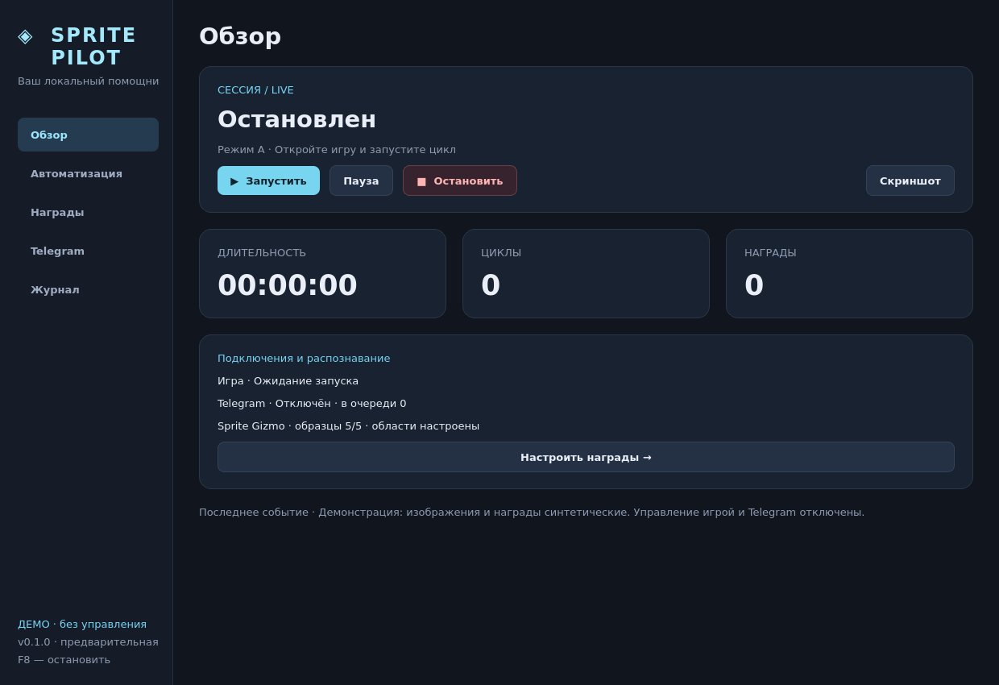

# Sprite Pilot

Приложение для Windows: циклы Fortnite, личная Telegram-панель и журнал наград с различением пяти вариантов Sprite Gizmo по иконке.

**Предварительная версия 0.1.0.** Проверены синтетические игровые кадры, поддельный Telegram API и интерфейс в Linux. Реальная игра, пять настоящих устройств, живой Telegram и сборка Windows EXE здесь ещё не проверены.



## Запуск

1. Установите **Python 3.12 x64** с Python Launcher (`py`).
2. Запустите `install_windows.bat` для установки зависимостей в локальную `.venv`.
3. Запустите `start_spritepilot.bat`.

Демонстрация без игры: `start_spritepilot.bat --demo`. Её синтетические изображения и временные данные не попадают в рабочую библиотеку; Telegram отключён.

Из терминала:

```powershell
py -3.12 -m venv .venv
.venv\Scripts\python -m pip install -e .
.venv\Scripts\python -m spritepilot
```

Откройте Fortnite на переднем плане. **F8** останавливает автоматику. Ввод выполняется только в найденном окне игры; при потере фокуса удерживаемые клавиши отпускаются.

## Что реализовано

- Режим A: обычный цикл через результаты матча. Режим B: ожидание на острове и выход через меню.
- Запуск, пауза, остановка, WASD, интервалы, пользовательские изображения кнопок.
- Отдельное наблюдение наград во время матча, галерея, дата и ID матча, ручное уточнение варианта.
- Избранные предметы, выбор уведомлений, пауза при избранной находке.
- Профили, журнал, статистика сессии и периодические сводки.
- SQLite-история и сохраняемая очередь Telegram с обработкой ошибок сети и `429`.

Это новая реализация интерфейса и интеграции на открытом ядре `ppkk12/fortnite-automatic-lap`, тег `v2.0.0`, MIT. **Это не полный перенос бинарного релиза 2.0:** режим C, фоновый захват/ввод, управление звуком, прыжок из автобуса и прочие расширения EXE не перенесены. Сейчас игра должна быть на переднем плане. Ошибочный декомпилированный код не используется как ядро. Сервер автора не вызывается; проверки лицензии оригинального EXE не изменялись. Исходный README: [README.upstream.md](README.upstream.md).

## Пять вариантов Sprite Gizmo

Надпись **SPRITE GIZMO** обнаруживает событие; тип устройства определяется **по иконке над ней**.

1. Сохраните полный кадр игры при получении предмета.
2. В «Награды» нажмите «Добавить образец».
3. Обведите общую надпись без иконки.
4. Обведите квадрат с устройством и выберите «Вариант 1…5».
5. Повторите для пяти устройств. В «Названия и избранное» задайте понятные имена.

До добавления всех пяти классов находки сохраняются как **«вариант не определён»**. Неоднозначное совпадение также не получает уверенного названия. В галерее можно уточнить вариант вручную и добавить вырезку в библиотеку.

Событие подтверждается на двух кадрах. Одна непрерывная плашка не создаёт повторов. Смена уверенно распознанной иконки может дать новое событие при той же надписи. Повтор того же устройства учитывается после исчезновения плашки. Процент — **сходство с образцом, не вероятность правильного ответа**.

Реальная точность требует игровых положительных и отрицательных примеров. Поисковый скриншот из обсуждения не используется как обучающий материал. Цифры на демонстрационных иконках синтетические.

## Telegram

Создайте бота через **@BotFather**, затем в разделе «Telegram» укажите токен, ваш числовой user ID и включите нужные разрешения. Откройте личный чат с ботом и отправьте `/panel`.

| Команда | Действие |
| --- | --- |
| `/panel` | Кнопки управления |
| `/status` | Состояние и статистика |
| `/start`, `/pause`, `/stop` | Управление при локально выданном разрешении |
| `/screenshot` | Свежий снимок окна игры при отдельном разрешении |
| `/rewards` | Последние 10 наград |
| `/wait 90` | Ожидание B: 10–600 секунд |

Кнопки переключают A/B и WASD. Восстановление включает Esc, центр окна, перезапуск цикла и сетку A1–D4. Оно доступно на паузе или при зависании. Сетка действует 60 секунд и только при неизменном размере окна.

Принимаются команды только от настроенного пользователя **в личном чате**. Группы и остальные пользователи игнорируются. Старые текстовые команды не воспроизводятся после запуска, update ID сохраняется. Не запускайте два клиента `getUpdates` с одним токеном.

Токен хранится через `keyring` в системном хранилище Windows, не записывается в настройки/журнал/профиль. Если хранилище недоступно, можно задать `SPRITEPILOT_TELEGRAM_TOKEN` через окружение; открытого файлового запасного хранилища нет. Нужен исходящий HTTPS к `api.telegram.org`. Discord, сервер автора и входящий порт не требуются. Лимиты Telegram обрабатываются, а не обходятся.

## Данные и сборка

Данные: `%LOCALAPPDATA%\SpritePilot`; переопределение через `SPRITEPILOT_DATA`.

- `settings.json`: настройки без токена;
- `journal.sqlite3`: находки, сессии, события и очередь;
- `templates/`: надпись и образцы пяти классов;
- `rewards/`: кадры и вырезки;
- `screenshots/`: запрошенные снимки;
- `buttons/`: свои изображения кнопок.

Снимки автоматически не удаляются. Профиль не содержит токена, Telegram ID, разрешений удалённого доступа или калибровки, зависящей от локальных изображений.

`build_spritepilot.bat` собирает `dist\SpritePilot`. Переносите папку **целиком**. Старый `build_exe.bat` собирает прежний интерфейс. Workflow [.github/workflows/spritepilot.yml](.github/workflows/spritepilot.yml) подготовлен для тестов и Windows-сборки с артефактом `SpritePilot-Windows`; на GitHub в этой сессии он не запускался.

```bash
python -m pip install -e . pytest
python -m pytest -q
QT_QPA_PLATFORM=offscreen python -m spritepilot --preview artifacts/overview.png
QT_QPA_PLATFORM=offscreen python -m spritepilot --preview artifacts/rewards.png --page 2
```

Тесты не отправляют настоящие сообщения и не управляют игрой. Проверяются пять классов с одинаковым текстом, неизвестные и похожие иконки, повторы, масштабирование, режимы, права Telegram, `retry_after`, смена получателя, отпускание клавиш и пять страниц интерфейса.

MIT. Авторство открытого ядра и изображений сохранено в [LICENSE](LICENSE) и [spritepilot/NOTICE.txt](spritepilot/NOTICE.txt).
